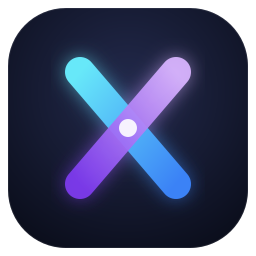
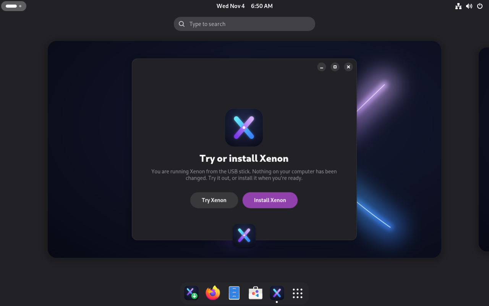
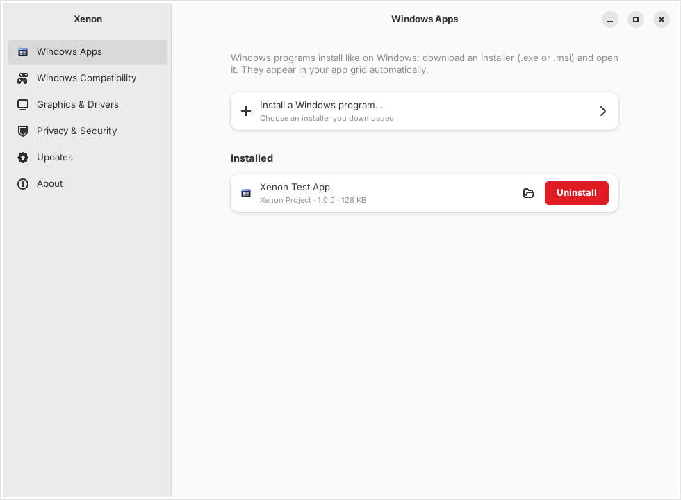
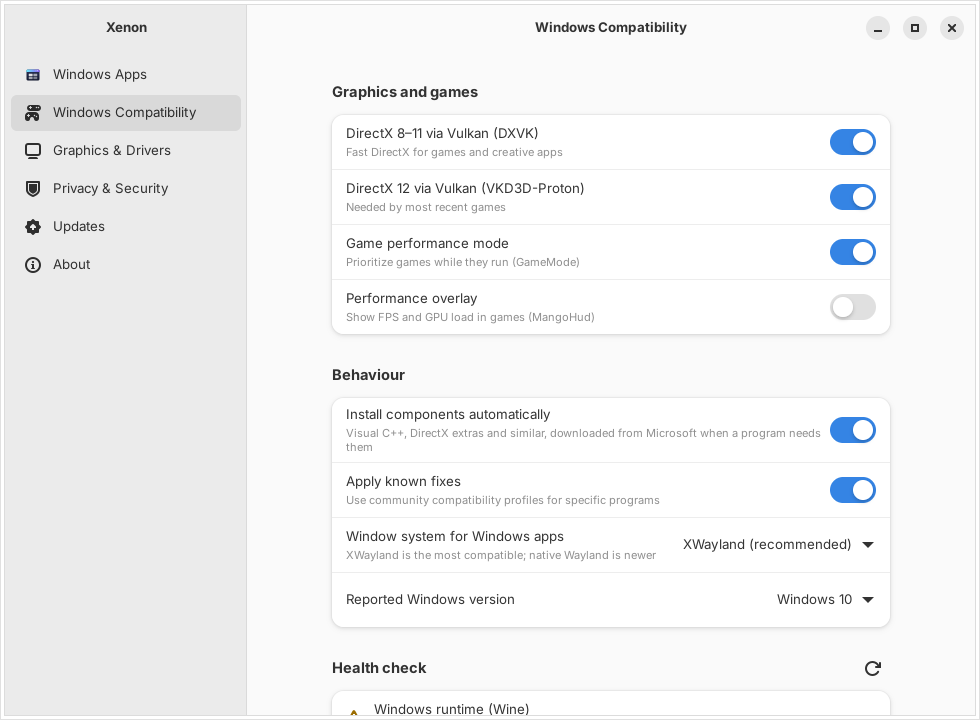
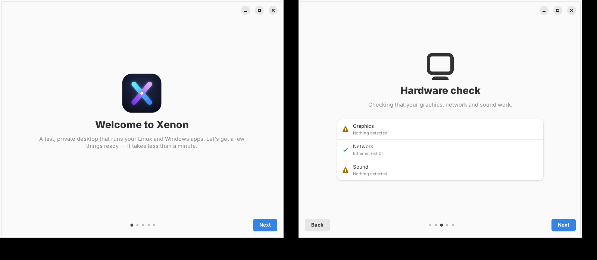

<p align="center">
  
</p>

<h1 align="center">Xenon</h1>

<p align="center">A clean, fast, private desktop OS that runs Linux <em>and</em> Windows apps.<br>
Built on Debian 13. Fully open source.</p>

---

Xenon is meant to replace Windows for everyday people: browse, work, make
music, edit photos and play games, without ads, tracking or bloat. Windows
programs are a built-in part of the system. Download an installer, open it,
and the app shows up in your app grid like any other.

<p align="center"></p>
<p align="center">
  
  
</p>
<p align="center"></p>

## What's in the box

| Layer | What Xenon uses |
|---|---|
| Kernel | Debian's signed backports kernel (NTSYNC, newest hardware support, Secure Boot) with `preempt=full` |
| Base | Debian 13 "trixie", minimal; PipeWire (low-latency), NetworkManager, zram swap |
| Graphics | Latest Mesa from backports (AMD, Intel, NVK); NVIDIA driver offered in the installer and Settings |
| **Xenon Windows Subsystem** | Wine (WineHQ stable) driven by `xws`: one managed Windows environment, drive mapping, app grid integration, runtimes on demand, compatibility profiles, registry snapshots, `.exe` via binfmt_misc |
| Games | DXVK (DirectX 8–11) and VKD3D-Proton (DirectX 12) built in; GameMode, MangoHud, Gamescope; controller permissions |
| Desktop | GNOME, lightweight, with a dock and tray icons; Xenon Settings and a first-boot Welcome |
| Apps | GNOME Software with Flathub; Windows `.exe`/`.msi` straight from the web |
| Installer | Calamares: erase disk or manual, dual boot, LUKS encryption, optional NVIDIA driver, UEFI + BIOS, Secure Boot |
| Privacy | No telemetry, firewall on, private Firefox defaults, no GeoIP lookups in the installer |

## Status

Xenon is at **0.1 (Phase 1 + Phase 2 foundations)**. Download the latest ISO from the newest green [ISO workflow run](https://github.com/Rybib/xenon/actions/workflows/iso.yml) (Artifacts → xenon-iso, needs a GitHub login; kept 14 days). Being straight about
what has been verified and what hasn't:

| Area | State |
|---|---|
| Windows Subsystem (`xws`) | **Tested end-to-end against real Wine in CI**: environment setup, DXVK deployment, 32-bit programs, running an installer, app grid entry, launching from the entry, installed-apps list, uninstall and cleanup (`packages/xenon-xws/tests/e2e.sh`) |
| Xenon Settings / Welcome | Runs and renders (screenshots in `docs/images/`); privileged actions (firewall, NVIDIA install) need a real install to verify |
| Debian packages | Build cleanly, with unit tests run during the build |
| Live ISO | **Builds, and boots to the desktop in CI**; the in-VM self-test passes (19 checks, including running a Windows program through XWS inside the ISO). Not yet booted on real hardware |
| Installer | Configured, **not yet run**: first install test pending (VM, then real hardware) |
| Priority apps (Adobe, Ableton, Office, Steam, Epic) | Profiles exist but are **untested**; see `docs/TESTING.md` |

Known limits, accepted from day one: games with **kernel-level anti-cheat**
(e.g. Valorant/Vanguard) and **Windows-only hardware drivers** won't work.
The goal is "basically everything" (95%+ of apps), not 100%.

## Quick start

Build the ISO (any Linux with Docker; about 30–60 minutes, roughly 4 GB):

```bash
tools/build-in-docker.sh
```

Boot-test it in a VM, which saves a desktop screenshot and an in-VM self-test report:

```bash
tools/test-iso.sh out/xenon-1.0-amd64.iso
```

Write it to a USB stick (replace `/dev/sdX`, as this erases the stick):

```bash
sudo dd if=out/xenon-1.0-amd64.iso of=/dev/sdX bs=4M status=progress oflag=sync
```

Develop the Windows subsystem without building an ISO:

```bash
make test        # unit tests
make e2e         # full install/launch/uninstall flow against your Wine
```

## Repository layout

```
build-iso.sh                 ISO build entry point (Debian 13, root)
live/                        live-build configuration (package lists, hooks)
debian/                      packaging for the xenon-* packages
packages/
  xenon-xws/                 Xenon Windows Subsystem (Python, no dependencies)
  xenon-xws-thirdparty/      DXVK, VKD3D-Proton, winetricks (pinned upstream releases)
  xenon-settings/            Xenon Settings + Welcome (GTK4/libadwaita) and xenon-admin
  xenon-system/              tuning, audio, controllers, privacy and GNOME defaults
  xenon-branding/            logo, wallpapers, Plymouth, GRUB, os-release
  xenon-installer/           Calamares configuration and install scripts
compat/profiles/             per-app compatibility profiles (TOML)
kernel/                      optional custom Xenon kernel build + config fragment
tools/                       package/ISO builders, QEMU boot test
docs/                        architecture, building, testing, roadmap, decisions
```

## Documentation

- [Architecture](docs/ARCHITECTURE.md): how the pieces fit together
- [Windows Subsystem](docs/XWS.md): how XWS works, the `xws` command, profiles
- [Building](docs/BUILDING.md): building packages and the ISO
- [Testing](docs/TESTING.md): VM testing and the real-hardware checklist
- [Roadmap](docs/ROADMAP.md): phases and what's next
- [Decisions](docs/DECISIONS.md): why things are the way they are
- [Hardware](docs/HARDWARE.md): compatibility list

## License

Xenon's own code is **GPL-3.0-or-later** (see `LICENSE`). Bundled
components keep their licenses: Wine (LGPL-2.1+), DXVK (zlib), VKD3D-Proton
(LGPL-2.1+), winetricks (LGPL-2.1+), Linux (GPL-2.0). Xenon never includes
leaked or proprietary Microsoft code. Microsoft redistributables are
downloaded from Microsoft on demand, never bundled.
